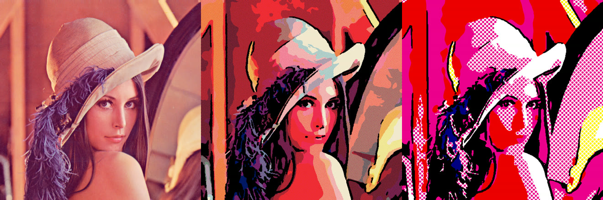
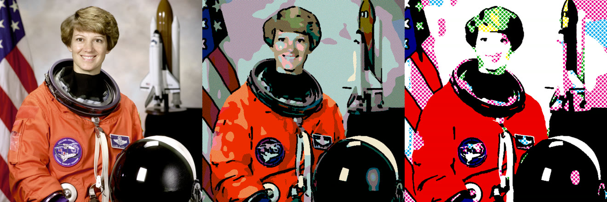
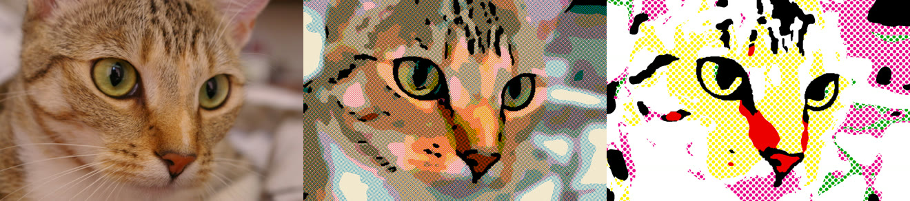
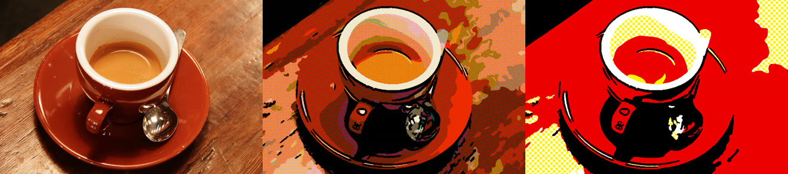
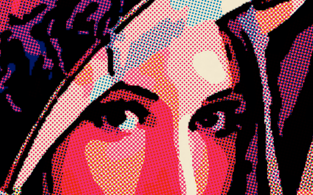

# benday-dots

[](https://crates.io/crates/benday-dots)
[](https://docs.rs/benday-dots)
[](#license)

Photos can be turned into old comic book prints.

Here is how it works. The image is broken up into a small number of regions of color, using the 64 tints available
to a comic book printer in the 1960s.

Each region is then printed using Ben-Day dots with the three inks (yellow, magenta and cyan), each at 0, 25, 50 or
100%. The three dot grids are laid slightly out of register on yellowed newsprint. On top of this go black ink
outlines and shadows.

An alternative preset produces large 45-degree dots, a limited color palette and white paper.

This is a command-line program, but the library could also be used in an image pipeline.

In each row below, the original is shown, the output with `--style comic`, and the output with `--style pop`. All
were produced with `--scale 3`.






Detail at 1:1:



## Install

```sh
cargo install benday-dots
```

## Command line

```sh
benday-dots photo.jpg print.png
benday-dots photo.jpg print.png --style pop
benday-dots photo.jpg print.png --dots-across 400 --scale 2 --paper white
benday-dots photo.jpg print.png --colors 8
```

It takes as input a PNG or JPEG and produces a PNG. Any of these flags will override the preset style. Most useful
flags include:

| Flag | Effect |
|---|---|
| `--style comic\|pop` | Which kind of look to use (default: comic). |
| `--dots-across N` | Number of rows of dots across the width of the output. For comic, default is 250; for pop, 70. |
| `--scale S` | How much bigger to make the output compared with the input. The dots get smaller but the shapes of the regions stay the same. |
| `--colors N` | Use k-means to pick N colors from the image, instead of the 64-tint chart. |
| `--inks aged\|process` | Use faded inks (newsprint) or crisp inks (modern). |
| `--paper newsprint\|white\|cover` | What color paper to use. |
| `--misregister`, `--dot-gain`, `--grain` | Add imperfections to the printing. Set to zero for a crisp print. |
| `--blacks L` | Areas of the image darker than lightness L (0 to 100) go solid black. |
| `--no-lines` | Skip the ink outlines. |
| `--dump-stages DIR` | Save the intermediate images, handy for tuning. |

`benday-dots --help` has the rest.

## Library

```toml
[dependencies]
benday-dots = { version = "0.1", default-features = false }
```

With the default features turned off, only in-memory conversion is included. No file I/O, no JPEG or PNG codecs and
no `clap`. The input is decoded pixels, the output is decoded pixels. Here's an example:

```rust
use benday_dots::{convert, Options};
use benday_dots::image::RgbImage;

fn comicify(frame: &RgbImage) -> Result<RgbImage, benday_dots::Error> {
    convert(frame, &Options::comic().dots_across(180.0))
}
```

If you aren't using the `image` crate in your pipeline, or if you're using a different version of it, you can pass
bytes into and out of `convert_raw`:

```rust
use benday_dots::{convert_raw, Options};

fn comicify(width: u32, height: u32, rgb: &[u8]) -> Result<Vec<u8>, benday_dots::Error> {
    // Tightly packed RGB8 in and out; the output is `scale` times the input size.
    let (_w, _h, pixels) = convert_raw(width, height, rgb, &Options::pop())?;
    Ok(pixels)
}
```

Another function, `convert_dynamic`, takes any `image::DynamicImage` (e.g. RGBA, greyscale, 16-bit). There is also
`convert_with_stages`, which returns the black ink mask and a map of tints for each pixel.

If you want to read or write files, don't turn off the `io` feature:

```rust,no_run
use benday_dots::{convert_file, Options};

fn main() -> Result<(), benday_dots::Error> {
    convert_file("photo.jpg", "print.png", &Options::pop().dots_across(90.0))
}
```

### Features

- `io` (default): JPEG/PNG support and `convert_file`.
- `cli` (implies `io`, default): the `benday-dots` command line tool.

## How it works

1. I shrink the photo to a usable size (by default 2000 pixels along the long side) and smooth it using a bilateral
   filter. This makes regions smooth but keeps edges sharp.
2. I up the contrast of the image, add a little more color saturation (but less for nearly grey pixels, to avoid
   pink skin and walls) and round each pixel to the closest available tint. Then I clean up the image, combining
   small regions and recoloring each one to its average.
3. Using an XDoG edge detector, I pick out ink lines. And I designate the darkest pixels as black.
4. Now, at full resolution, I render each ink as round dots at its own angle, combine the inks on the paper color,
   then add on the black.

All of the processing of regions happens on the shrunk image. So increasing `--scale` will only slow down the dot
pass.

On an 18-thread laptop, a 12-megapixel photo will take around half a second to go through JPEG decoding, PNG
encoding and all of this processing.

My code for step 1 is hand-optimized AVX2 and is used conditionally at runtime. There is also a portable fallback
for other CPUs.

## License

You may use it under either

- Apache License, Version 2.0 ([LICENSE-APACHE](LICENSE-APACHE) or <https://www.apache.org/licenses/LICENSE-2.0>)
- MIT license ([LICENSE-MIT](LICENSE-MIT) or <https://opensource.org/licenses/MIT>)

at your option.

`src/deflate.rs` is based on [fdeflate](https://github.com/image-rs/fdeflate) (MIT OR Apache-2.0).

Unless you specifically indicate otherwise, any original contribution you make to this project, within the meaning
of the Apache-2.0 license, will be available under the licenses above (no other terms or conditions).

### Example images

Here are the images used in the examples. They're all standard ones used in image processing:

- Lenna (Lena Forsén) from the USC-SIPI image database.
- Astronaut Eileen Collins, NASA (public domain).
- Chelsea the cat, by Stéfan van der Walt (CC0).
- Coffee, by Rachel Michetti of Pikolo Espresso Bar (CC0).

The last three are from [scikit-image](https://github.com/scikit-image/scikit-image).
